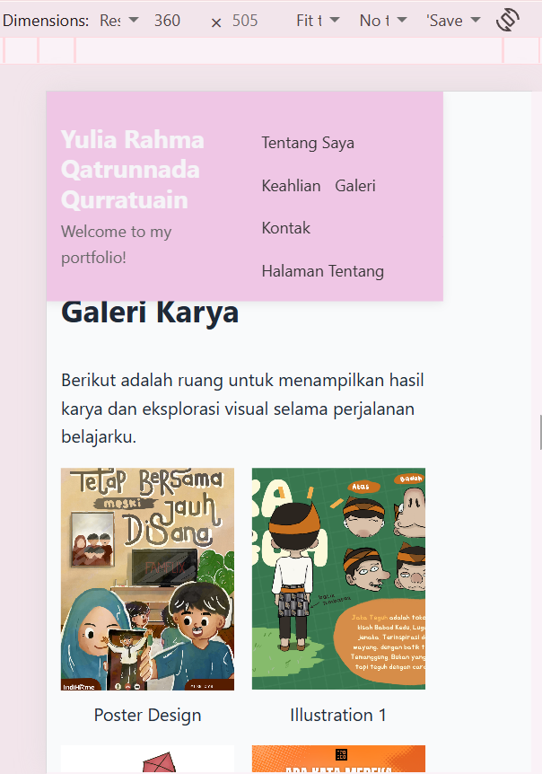
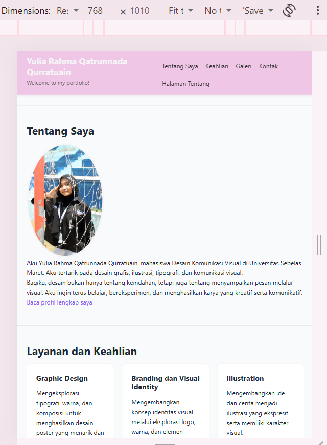
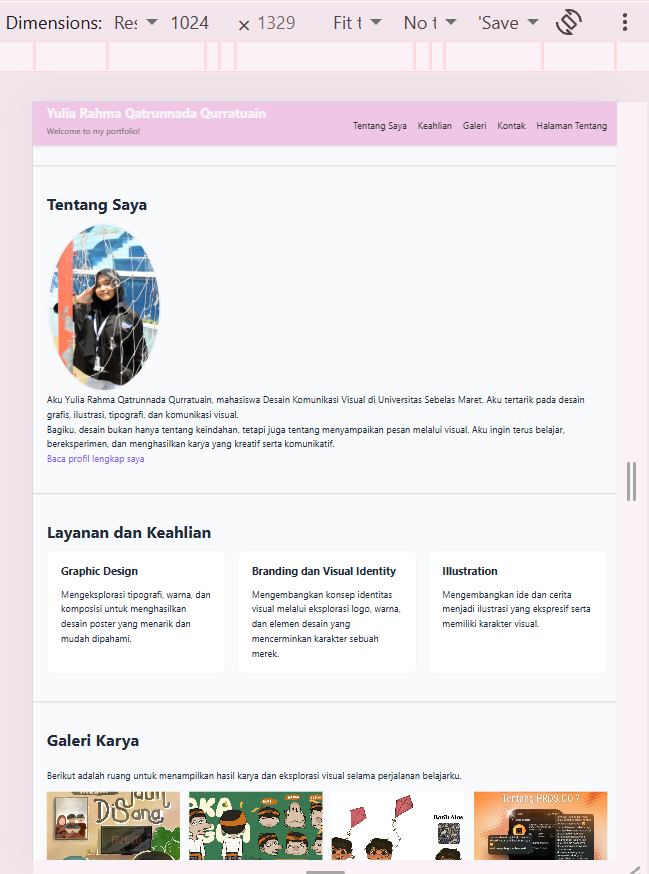

# Hari 3 - Proyek 1: Landing Page Portofolio Responsif

Landing page portofolio pribadi untuk seorang mahasiswa Desain Komunikasi Visual (DKV), dibuat dengan HTML5 dan CSS3 murni. Tata letaknya responsif (mobile-first) dengan Flexbox dan Grid. Proyek ini bagian dari portofolio diklat **Junior Web Programmer** (Hari 3 - CSS3, Flexbox, Grid, dan Desain Responsif).

## Demo

**Lihat situs:** https://yurayuliaa.github.io/portofolio-junior-web/hari-03-css/

## Tema

Portofolio visual bertema desain komunikasi visual dengan tagline *"Turning Ideas Into Visual Stories"*. Halaman memperkenalkan pemiliknya, menampilkan keahlian (graphic design, branding, dan ilustrasi), galeri karya, daftar layanan dan harga, serta formulir kontak. Palet warna yang dipakai adalah pink dan ungu lembut.

## Fitur

- Header menempel di atas (`position: sticky`) dengan navbar Flexbox
- Penanda menu aktif memakai `:target` dan `:has()`, jadi tanpa JavaScript
- Hero perkenalan dengan tautan ke galeri
- Bagian Tentang dengan foto profil berbingkai bulat
- Kartu keahlian dengan CSS Grid: 1 kolom (ponsel), 2 kolom (tablet), 3 kolom (laptop)
- Galeri karya dengan CSS Grid: 2 kolom (ponsel) dan 4 kolom (768 px ke atas), dengan efek zoom saat `:hover`
- Tabel daftar layanan dan harga yang dibungkus agar bisa digulir horizontal di layar kecil
- Formulir kontak dengan gaya `:focus` yang jelas
- Efek `:hover` pada tombol, kartu, dan gambar galeri
- Warna utama, jarak, radius, dan lebar maksimum dikelola lewat variabel CSS

## Struktur Halaman

| Bagian | ID | Layout |
|---|---|---|
| Header dan navbar | `#beranda` | Flexbox |
| Hero | - | Alur normal |
| Tentang Saya | `#tentang` | Alur normal |
| Layanan dan Keahlian | `#keahlian` | Grid (kartu) |
| Galeri Karya | `#galeri` | Grid |
| Harga dan Jadwal | `#harga` | Tabel |
| Kontak | `#kontak` | Formulir |
| Footer | - | Alur normal |

## Teknologi

| Teknologi | Penggunaan |
|---|---|
| HTML5 | Struktur semantik (`header`, `nav`, `main`, `section`, `article`, `figure`, `footer`) |
| CSS3 | Styling dalam satu berkas `css/style.css` |
| Flexbox | Navbar dan menu |
| CSS Grid | Kartu keahlian dan galeri |
| CSS Variables | Warna utama, jarak, radius, lebar maksimum |
| Media Query | Tata letak responsif (mobile-first) |
| GitHub Pages | Hosting situs |

## Breakpoint Responsif

| Lebar layar | Perubahan |
|---|---|
| di bawah 768 px | Navbar menumpuk, kartu 1 kolom, galeri 2 kolom |
| 768 px ke atas | Navbar sebaris, kartu 2 kolom, galeri 4 kolom |
| 1024 px ke atas | Kartu 3 kolom |

## Tangkapan Layar

### Tampilan ponsel (360 px)



### Tampilan tablet (768 px)



### Tampilan desktop (1024 px)



## Skor Lighthouse

Diukur pada situs yang sudah dipublikasikan di GitHub Pages.

| Kategori | Skor | Target |
|---|---|---|
| Performance | 71 | - |
| Accessibility | 96 | minimal 85 |
| Best Practices | 100 | minimal 85 |
| SEO | 100 | minimal 85 |

## Dokumentasi Pendukung

- [Tabel temuan Bug Hunt dan uji responsif](bug-hunt.md)
- [Hasil code review sejawat](code-review.md)

## Cara Menjalankan Secara Lokal

1. Clone repositori ini:
   ```bash
   git clone https://github.com/yurayuliaa/portofolio-junior-web.git
   ```
2. Buka folder `hari-03-css`.
3. Buka berkas `index.html` di browser.

## Catatan Pengembangan

- Satu berkas CSS: variabel, reset, layout, komponen, dan responsif
- Tanpa `style` inline dan tanpa `!important`
- Penamaan class deskriptif berhuruf kecil dengan tanda hubung (contoh: `kartu`, `grid-kartu`, `tabel-bungkus`)
- Semua gambar memiliki atribut `alt`, dan halaman memiliki `lang`, `title`, serta `meta description`