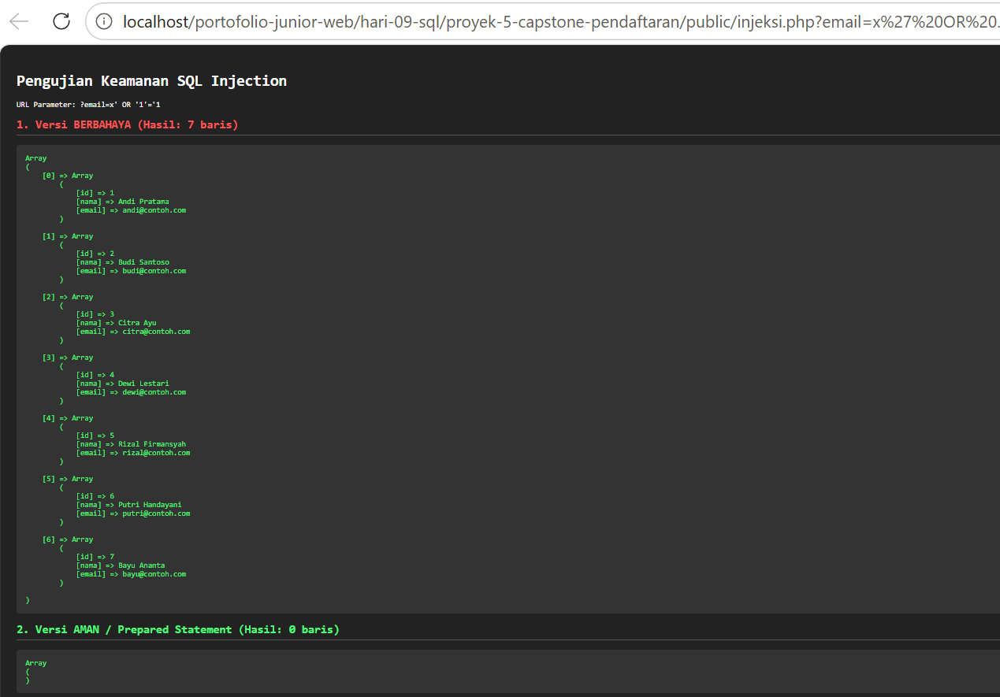

Prepared statement bekerja dengan memisahkan struktur perintah SQL dari data masukan pengguna. Dengan begitu, masukan berbahaya dari pengguna tidak akan pernah bisa disusupkan menjadi perintah SQL baru.
# Analisis Keamanan SQL Injection

1. Parameter Pengujian
URL Pengujian: `http://localhost/.../public/injeksi.php?email=x' OR '1'='1`
Tujuan: Membandingkan penanganan query SQL mentah dengan *Prepared Statement* PDO.

2. Hasil Eksekusi & Penjelasan

*Versi Berbahaya* (Hasil: 7 baris):
    **Penyebab**: Input pengguna disambung langsung ke dalam string query SQL (`WHERE email = '$email'`).
    **Dampak:** Karakter petik tunggal (`'`) memutus string, dan perintah `OR '1'='1'` bernilai selalu benar (*TRUE*), sehingga MySQL menampilkan seluruh data pendaftar yang ada di database.

*Versi Aman* / Prepared Statement (Hasil: 0 baris):
    **Penyebab:** Menggunakan `$pdo->prepare()` dengan placeholder `:email`.
    **Dampak:** MySQL memperlakukan seluruh teks `x' OR '1'='1` murni sebagai data/string mentah, bukan kode SQL. Karena tidak ada email yang persis sama dengan string tersebut, hasil yang dikembalikan adalah 0 baris.

3. Kesimpulan
Penggunaan *Prepared Statement* memisahkan struktur perintah SQL dari data masukan pengguna, sehingga efektif mencegah serangan SQL Injection.

4. SS bukti

